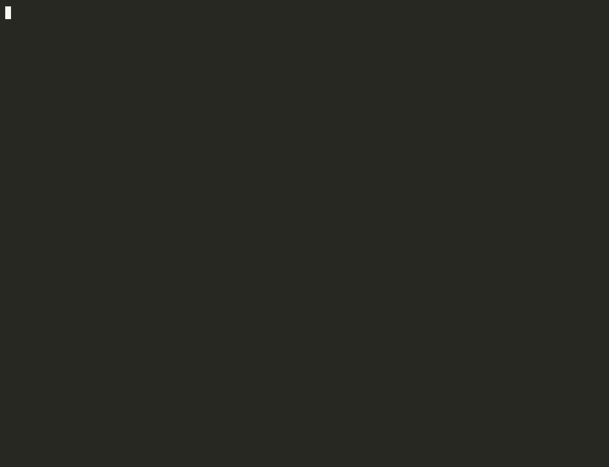

# AsciiArtify — Concept: local Kubernetes for the PoC

AsciiArtify is a two-engineer startup building an ML-powered service that turns images into ASCII
art. Before investing in cloud infrastructure, the team needs a local Kubernetes environment for
the Proof of Concept: something that is fast to start, close enough to a real multi-node cluster,
and cheap to run on a developer laptop. This document compares three candidates — **minikube**,
**kind** and **k3d** — and recommends one for the PoC.

All three tools were installed and used hands-on. Every timing and resource number below was measured on the same
machine (WSL2 on Windows, Docker Desktop 29.9.3, 32 CPU / 30 GiB) on 2026-11-11, with the same
cluster shape (1 control plane + 2 workers) and the same app ([`demo/hello-world.yaml`](../demo/hello-world.yaml)).

## Introduction

| Tool | What it is | Purpose |
|---|---|---|
| [minikube](https://minikube.sigs.k8s.io/) | Runs a Kubernetes cluster (kubeadm-based) in a VM or in containers on the local machine. A Kubernetes SIG Cluster Lifecycle project. | Local development and learning Kubernetes; the most feature-rich of the three (addons, dashboard, many drivers). |
| [kind](https://kind.sigs.k8s.io/) (Kubernetes IN Docker) | Runs each Kubernetes node as a container, using the upstream `kubeadm` bootstrap. A Kubernetes SIG Testing project. | Built to test Kubernetes itself; widely used in CI pipelines and for conformance testing. |
| [k3d](https://k3d.io/) | A lightweight wrapper that runs [k3s](https://k3s.io/) nodes as Docker containers. A community-driven project ("not an official Rancher (SUSE) product"). | Fast, lightweight multi-node clusters for local development and CI. |

> **A note on k3d and RKE.** The task brief says k3d uses Rancher Kubernetes Engine (RKE). In fact
> k3d runs **k3s** — Rancher's lightweight, CNCF-certified Kubernetes distribution packaged as a
> single binary. RKE / RKE2 are separate Rancher products for full-size clusters. The distinction
> matters for the PoC: k3s ships with its own batteries (Traefik ingress, ServiceLB load balancer,
> metrics-server, local-path storage), which is a large part of why k3d feels "ready out of the box".

## Characteristics

| Characteristic | minikube v1.39.0 | kind v0.33.0 | k3d v5.9.0 |
|---|---|---|---|
| Maintainer / governance | Kubernetes SIG Cluster Lifecycle | Kubernetes SIG Testing | community project (k3d-io), not an official SUSE product; k3s: CNCF Sandbox, originated at Rancher |
| Kubernetes distribution (default version) | upstream kubeadm (v1.37.0) | upstream kubeadm (v1.37.0) | k3s (v1.35.5-k3s1; any k3s via `--image`) |
| How nodes run | VM or container per node | container per node | container per node + a load-balancer container |
| Drivers / runtimes | containers: Docker, Podman (experimental); VMs: KVM2, QEMU, VirtualBox, Hyper-V, vfkit, Parallels, VMware; `none` (bare metal) | Docker, Podman, nerdctl (auto-detected) | Docker (≥ 20.10.5); Podman (experimental) |
| OS / architectures (binaries) | Linux, macOS: amd64, arm64 (+ ppc64le, s390x on Linux); Windows: amd64 only | Linux, macOS: amd64, arm64; Windows: amd64 only | Linux, macOS: amd64, arm64 (+ 386, arm on Linux); Windows: amd64 only |
| Multi-node / HA control plane | `--nodes N`; `--ha` (3 control planes) | roles in the cluster config file | `--agents N`; `--servers 3` (embedded etcd) |
| Host access to a service | `minikube service --url`, `minikube tunnel` (terminal must stay open); no static host port with multi-node on the Docker driver | `extraPortMappings` in the cluster config | `-p 8888:30080@loadbalancer` on create |
| LoadBalancer out of the box | no — `minikube tunnel` | no — [cloud-provider-kind](https://github.com/kubernetes-sigs/cloud-provider-kind) (separate, alpha) | **yes** — k3s ServiceLB |
| Ingress out of the box | `ingress` addon (ingress-nginx, archived upstream 2026-03-24) or new Traefik addon | no — cloud-provider-kind ≥ v0.9.0 adds Ingress / Gateway API | **yes** — Traefik v3 |
| Addons / extras | ~40 addons (dashboard, metrics-server, registry, ingress…) | none — minimal by design | k3s bundle: Traefik, ServiceLB, metrics-server, local-path storage, CoreDNS |
| Dashboard / monitoring | `minikube dashboard` (Kubernetes Dashboard addon); metrics via addon | none | none; `kubectl top` works out of the box (metrics-server) |
| Config as code / automation | CLI flags + `minikube config set` (no cluster config file) | declarative YAML cluster config | declarative YAML cluster config; single CLI command also enough |
| Image loading / local registry | `minikube image load`, `registry` addon | `kind load docker-image`, documented local-registry setup | `k3d image import`, `k3d registry create` / `--registry-create` |
| Node image size (pulled) | `kicbase` 1.89 GB + preload 348 MB | `kindest/node` 1.34 GB | `rancher/k3s` 337 MB (+ proxy 106 MB, tools 35 MB) |
| Cluster start, cold → warm[^measure] | 103.3 s → 74.2 s | 61.9 s → 38.2 s | — → **28.8 s**[^k3dcold] |
| Cluster delete | ~13 s | ~1 s | ~4 s |
| App deploy: `apply` → first successful `curl` | 6.8 s (via `port-forward`) | 7.2 s | 20.5 s (k3s installs Traefik in parallel) |
| RAM, 3 nodes idle + app | ~860 MiB | ~920 MiB | ~1.2 GiB (includes Traefik + metrics-server) |
| License | Apache 2.0 | Apache 2.0 | MIT (k3s: Apache 2.0) |
| Documentation[^docs] | ★★★ extensive | ★★☆ focused | ★★☆ adequate, partly stale |
| Community / activity[^community] | ★★★ | ★★☆ | ★☆☆ (k3s itself: ★★★) |
| Ease of setup for the PoC scenario[^complexity] | ★☆☆ multi-node + host access is awkward | ★★☆ needs a config file | ★★★ one command |

★★★ = best of the three for that criterion, ★☆☆ = weakest.

[^measure]: `create` + `kubectl wait --for=condition=Ready node --all`, 1 control plane + 2 workers.
    Cold = first run including the node-image pull, warm = images already cached.
[^k3dcold]: k3d cold start was not measured: the k3s images were already cached from another
    local cluster. The two demo recordings confirm the warm number: `k3d cluster create` alone took
    30.5 s and 28.4 s.
[^docs]: Official sites checked 2026-11-11. minikube: quick start, config, multi-node and HA,
    networking, ingress / LoadBalancer, registry, Podman, WSL, troubleshooting and FAQ pages,
    24 tutorials. kind: quick start, config, ingress, LoadBalancer, local registry, rootless,
    WSL2 and known-issues pages; the known-issues page states the team "is not able to provide
    support with Windows and WSL". k3d: quick start, config file, multi-server, networking,
    exposing services, registries, Podman and FAQ pages; no WSL / Windows page, and the
    compatibility page still stops at k3d v5.4.0 (2022).
[^community]: GitHub REST API, 2026-11-11 — stars / contributors / open issues / open PRs / merged
    PRs in the last 12 months / releases in the last 12 months (latest):
    minikube 32.2k / ~1116 / 483 / 145 / 951 / 3 (v1.39.0, 2026-09-02);
    kind 15.6k / ~379 / 201 / 51 / 100 / 3 (v0.33.0, 2026-08-26);
    k3d 6.6k / ~157 / 249 / 72 / 15 / 1 (v5.9.0, 2026-06-02);
    k3s 34.4k stars, 100+ releases in 12 months (latest v1.37.2+k3s1, 2026-11-03), CNCF Sandbox since 2020.
    Channels: #minikube and #kind on Kubernetes Slack (plus minikube office hours and mailing lists),
    #k3d on Rancher Slack.
[^complexity]: Scenario: 3-node cluster with the app reachable from the host, as in the demo.
    minikube is simple for a single node with addons, but on the Docker driver `--ports` breaks with
    `--nodes 3` (the port mapping is applied to every node container and the second node fails
    with "port is already allocated"), so host access needs a foreground `minikube service` or
    `minikube tunnel`. kind needs a cluster config with `extraPortMappings`. k3d needs one flag.

## Advantages and disadvantages

### minikube

**Advantages**
- Most complete feature set: ~40 addons, built-in Kubernetes Dashboard, `tunnel` for LoadBalancer
  services, HA control plane.
- The only tool that needs no Docker or Podman on the host: VM drivers (KVM2, Hyper-V, vfkit,
  QEMU, VirtualBox…) run the container runtime inside the VM, give full isolation and sidestep
  Docker licensing entirely.
- Lowest RAM in our test (~860 MiB for 3 nodes) and the fastest first deploy (6.8 s).
- Best documentation and the largest community (Kubernetes SIG project, ~1.1k contributors,
  office hours, 24 tutorials incl. a WSL page) — easiest tool to learn Kubernetes with.
- Upstream (kubeadm) Kubernetes, current minor (v1.37).

**Disadvantages**
- Slowest to start and the largest download: 74 s warm / 103 s cold, ~2.2 GB of node images.
- Stability (hands-on): the only hard failure in our tests — `--ports` with `--nodes 3` on the
  Docker driver left the second node unable to start; single-node use was solid.
- Multi-node on the Docker driver is the weak spot: no static host port, access only through
  commands that must keep a terminal open; the random `service --url` port changes on every run.
- The `ingress` addon still ships ingress-nginx, whose upstream repository was archived on
  2026-03-24 (no more fixes); the new Traefik addon is the way forward.
- Cluster configuration is flags-only — no declarative cluster config file to commit.

### kind

**Advantages**
- Upstream Kubernetes, current minor (v1.37), prebuilt node images for several minor versions —
  closest to a "real" kubeadm cluster; the Kubernetes project uses it for its own CI.
- Stability (hands-on): no issues — create, port mapping, load balancing and delete worked first
  time; the most predictable of the three.
- Declarative cluster config (YAML) that lives in the repo; minimal and predictable.
- Fast teardown (~1 s), solid start (38 s warm), lean RAM (~920 MiB for 3 nodes).
- Best Podman story of the three: auto-detects Docker / Podman / nerdctl; Podman Desktop ships a
  built-in kind extension. `kindest/node` is a Docker Sponsored OSS image (no pull-rate limits).

**Disadvantages**
- Nothing beyond the bare cluster: no LoadBalancer, no ingress controller, no metrics-server, no
  dashboard. cloud-provider-kind fills the gap but is a separate, "very alpha" component that
  needs sudo on macOS / WSL2.
- Host ports must be planned up front in the cluster config (`extraPortMappings`); changing them
  means recreating the cluster.
- Limited Windows / WSL backing: there is a WSL2 docs page, but the known-issues page says the
  team is "not able to provide support with Windows and WSL".

### k3d

**Advantages**
- Fastest start (~29 s warm for 3 nodes) and smallest download (k3s image 337 MB).
- Production-like features out of the box thanks to k3s: Traefik ingress, ServiceLB load
  balancer, metrics-server (`kubectl top` works), local-path storage.
- Simplest multi-node + host access: one command, `-p host:nodePort@loadbalancer`, traffic is
  balanced across nodes (seen in the demo).
- Good developer ergonomics: `k3d image import`, built-in local registry, YAML config file, easy
  multi-cluster on one machine.
- Stability (hands-on): no failures across the phase-1 test and two demo recordings; k3s itself
  is a production-grade distribution (edge / IoT).

**Disadvantages**
- k3s is not upstream kubeadm Kubernetes (single binary, SQLite / embedded etcd, different
  defaults); fine for app development, not for testing cluster-level behaviour.
- The default k3s version lags (v1.35.5 vs v1.37 upstream) — pin a newer `rancher/k3s` image with
  `--image` when it matters.
- Smallest and least active project of the three: 1 release and 15 merged PRs in the last
  12 months, ~157 contributors, community-driven (not an official SUSE product). The heavy lifting
  is done by k3s, which is healthy (CNCF Sandbox, frequent releases), so the risk is limited to the
  thin wrapper.
- Bundled components cost RAM: ~1.2 GiB for 3 nodes, the most of the three in this setup.
- Slowest first deploy on a fresh cluster: `apply` → first `curl` 20.5 s vs ~7 s for kind and
  minikube, because k3s installs Traefik (a Helm job) right after cluster creation. One-time cost
  per cluster; skip it with `--k3s-arg '--disable=traefik@server:*'` when ingress isn't needed.
- Docker-centric: Podman support is "experimental … not guaranteed to work"; no WSL page in the docs.

## Docker licensing and Podman as an alternative

**Where the licensing risk is.** All three tools are open source (Apache 2.0 / MIT) and free.
The risk is **Docker Desktop**, the usual way to run them on macOS and Windows. Under the
[Docker Subscription Service Agreement](https://www.docker.com/legal/docker-subscription-service-agreement/)
(§3.2, updated 2026-08-26), Docker Desktop is free only for personal use, education,
non-commercial open source and *"use in a commercial undertaking with fewer than 250 employees and
less than US \$10,000,000 … in annual revenue"*; government entities always need a paid plan. Paid
plans are Pro / Team / Business at \$9 / \$15 / \$24 per user per month (annual billing,
[pricing](https://www.docker.com/pricing/), 2026-11-11). Docker Engine and the Docker CLI on Linux
remain open source under Apache 2.0 and need no subscription
([docs](https://docs.docker.com/engine/)).

**What it means for AsciiArtify.**
- Today (2 engineers, revenue well below \$10M): Docker Desktop is free — no cost, no blocker.
- Risk after growth or funding: crossing 250 employees **or** \$10M revenue makes every developer
  seat a paid Docker subscription; a government customer requires one immediately. The cost is
  modest, but it must be budgeted and audited (Docker reserves the right to audit usage).
- Separate operational risk: Docker Hub pull limits — 100 pulls per 6 h unauthenticated, 200 when
  logged in on a free account ([docs](https://docs.docker.com/docker-hub/usage/pulls/)). Recreating
  clusters often in CI can hit them; log in or use a pull-through cache. (`kindest/node` is exempt
  as a Sponsored OSS image.)
- Mitigations: Linux machines and CI runners use Docker Engine (free); macOS / Windows developers
  can switch to Podman Desktop, Rancher Desktop (Apache 2.0) or Colima (MIT, macOS / Linux).
  Rancher Desktop and Colima run a Docker-compatible engine, so all three tools keep working
  unchanged; on Podman support varies (table below). Note that OrbStack, a popular macOS option,
  is commercial software too.

**Podman.** [Podman](https://podman.io/) is a daemonless container engine that can run rootless,
licensed Apache 2.0, a CNCF Sandbox project since January 2025 (latest stable 6.1.4). On macOS and
Windows it runs containers in a `podman machine` VM; it exposes a Docker-compatible API via
`podman.socket`, so most Docker tooling works through `DOCKER_HOST`. Podman Desktop adds a GUI and
can create kind and minikube clusters.

| | minikube | kind | k3d |
|---|---|---|---|
| Podman support | `podman` driver, documented as **experimental**; on Linux needs passwordless sudo, or rootless mode (`--rootless`, containerd recommended) | **auto-detected** (`KIND_EXPERIMENTAL_PROVIDER=podman` to force it); rootless needs cgroup v2 delegation; built-in extension in Podman Desktop | **experimental**, "not guaranteed to work"; Podman v4+ via the Docker-API socket (`DOCKER_HOST`); rootless needs a cgroup v2 delegation drop-in; `--registry-create` unsupported |
| Without Docker Desktop | any engine above, or **VM drivers** — no Docker or Podman on the host | Docker Engine, Podman, nerdctl | any Docker-compatible engine (Docker Engine, Rancher Desktop, Colima); Podman via the Docker-API socket (experimental) |

**Assessment.** Leaving Docker Desktop does not mean leaving k3d: it runs on any Docker-compatible
engine (Docker Engine on Linux, Rancher Desktop, Colima). Podman is a credible alternative too, but
the tools differ on it: kind has the best Podman support, minikube can skip a host container
engine with VM drivers, k3d is the weakest here. For the PoC none of this is a blocker — the team
qualifies for free Docker Desktop. If Podman specifically becomes a requirement, the move is
k3d → kind on Podman (or minikube with a VM driver); the application manifests stay the same.

## Demonstration

Hello World on a 3-node k3d cluster: create the cluster, deploy the app, reach it from the host,
scale to 4 replicas and watch requests spread across pods on different nodes, delete the cluster.



The app is [`hashicorp/http-echo`](https://github.com/hashicorp/http-echo) answering with an ASCII
"AsciiArtify" banner and the pod / node that served the request
([`demo/hello-world.yaml`](../demo/hello-world.yaml): Deployment with 2 replicas + NodePort Service
on 30080).

```bash
k3d cluster create asciiartify --agents 2 -p '8888:30080@loadbalancer' --wait
kubectl wait --for=condition=Ready node --all --timeout=120s
kubectl apply -f demo/hello-world.yaml
kubectl rollout status deployment/hello-world --timeout=120s
curl -s localhost:8888

kubectl scale deployment/hello-world --replicas=4
kubectl rollout status deployment/hello-world --timeout=120s
for i in $(seq 8); do curl -s localhost:8888 | tail -n 1; done

k3d cluster delete asciiartify
```

> **WSL2 / Docker Desktop caveat (all three tools).** Windows reserves TCP port ranges dynamically
> (Hyper-V / WinNAT). If the host port falls into one of them, Docker Desktop drops the port
> mapping **without an error** — the cluster comes up, but `curl` hangs. This happened with port
> 8088 during the recording; check `netsh interface ipv4 show excludedportrange protocol=tcp` and
> pick a free port.

## Conclusions

**Recommendation for the AsciiArtify PoC: k3d.**

- It is the fastest to create and recreate (~29 s for 3 nodes), the smallest download, and the
  only tool where a multi-node cluster with a load balancer, ingress and metrics works with a
  single command — exactly what a two-person team needs to iterate on the app instead of on the
  cluster.
- k3s is a CNCF-certified Kubernetes, so standard manifests written for the PoC (Deployments,
  Services, Ingress) carry over to a managed cluster later; only the ingress controller and the
  load-balancer implementation will differ.
- Known trade-offs, accepted for the PoC: k3d is a small, slow-moving project (mitigated by k3s
  doing the heavy lifting and by easy migration to kind); default k3s version lags upstream (pin
  the image); slower first deploy while Traefik installs; weak Podman support (any Docker-compatible
  engine works, and Docker Desktop is free for the team today).

**Where the other tools fit.**
- **kind** — the choice for CI and for testing against upstream Kubernetes versions (conformance,
  operators, cluster-level behaviour), and the fallback if the team moves to Podman.
- **minikube** — best for learning Kubernetes, for single-node development with rich addons and a
  dashboard, and for Docker-free setups via VM drivers. Not a good fit for multi-node work on the
  Docker driver.

**Revisit the decision when:**
- the company approaches the Docker Desktop thresholds (250 employees or \$10M revenue) — replace
  Docker Desktop (Docker Engine on Linux, Rancher Desktop, Colima) or buy seats; k3d can stay;
- Podman becomes a requirement — move to kind on Podman;
- k3d stops getting releases — move to kind (manifests unchanged).
