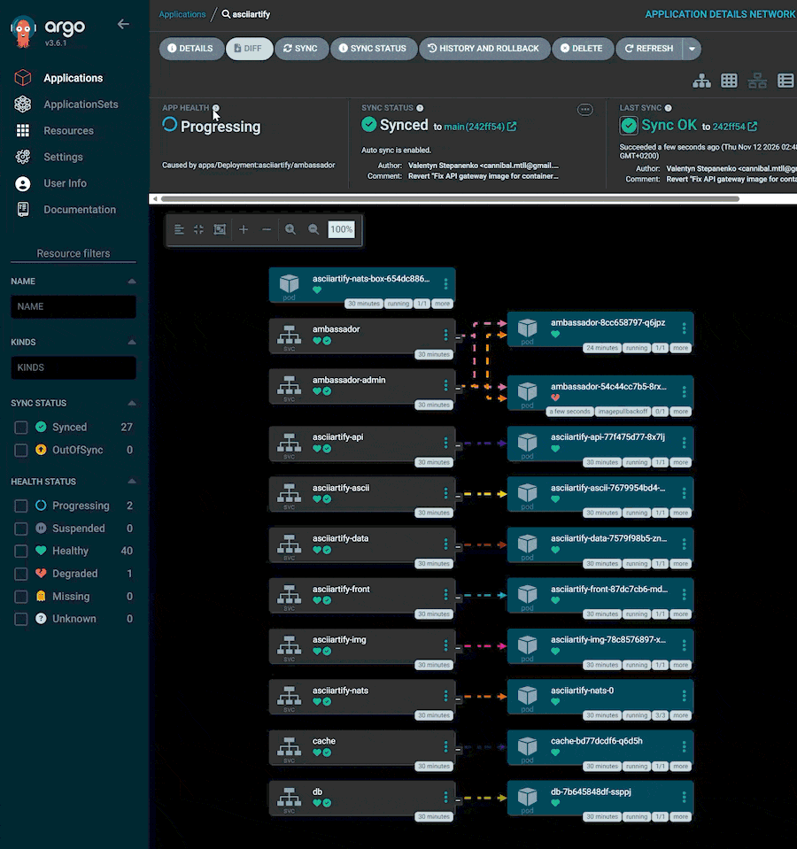
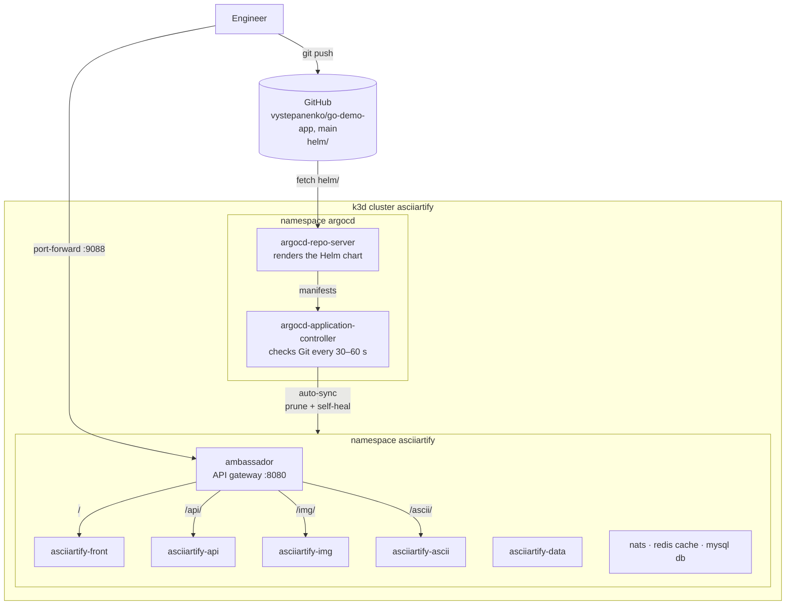

# AsciiArtify — MVP: the product deployed through Argo CD

The [PoC](POC.md) proved that Argo CD on k3d deploys an application from Git and keeps it in sync.
For the MVP, Argo CD deploys the product itself: the AsciiArtify demo application
[`go-demo-app`](https://github.com/den-vasyliev/go-demo-app), forked to
[`vystepanenko/go-demo-app`](https://github.com/vystepanenko/go-demo-app). Argo CD tracks the
`main` branch of the fork and syncs every change automatically. Developers ship a fix or a feature
with `git push`, and nobody runs `kubectl apply` or `helm upgrade` by hand.

Result: the `asciiartify` Application deploys the product's Helm chart from the fork to the
`asciiartify` namespace. The image upload endpoint turns a picture into colour ASCII art. A fix
pushed to the fork was live **76 s** after `git push`, with no manual steps: Argo CD picked the
commit up after 42 s, synced it in 1 s, and the rolled-out pod was ready 33 s later (see
[Measured on the MVP machine](#measured-on-the-mvp-machine)).

All steps below were run on the PoC cluster (WSL2 on Windows, Docker Desktop 29.9.3, k3d v5.9.0,
k3s v1.35.5, Argo CD v3.6.1) on 2026-11-12.

## Demo

**The product and the automatic sync, terminal:** the Application deployed from the fork is
Synced but stuck in Progressing because the API gateway image cannot be pulled. A fix is pushed to
the fork, Argo CD picks it up on its own, and the gateway turns an uploaded image into ASCII art.
This recording is the proof of the automatic sync: from `git push` to Healthy nobody clicks
anything or runs `kubectl` other than to watch, and the Application history records the sync as
`automated`.


**The Argo CD UI**, a separate take to show the interface. To fit the recording into 30 s, the
sync in it was started with **Sync** by hand. The automatic sync is what the terminal recording
above shows. In the UI: after a bad commit the app is Progressing and the new `ambassador` pod
cannot pull its image. Once the fix is synced, the broken pod goes away and the app turns Healthy.



## How it fits together



| Component | Version / value |
|---|---|
| Cluster, Argo CD | the PoC setup: k3d `asciiartify`, Argo CD v3.6.1 ([PoC steps 1–3](POC.md#1-create-the-cluster)) |
| Product repository | fork [`vystepanenko/go-demo-app`](https://github.com/vystepanenko/go-demo-app), branch `main`, Helm chart in `helm/` |
| Application | [`argocd/asciiartify-app.yaml`](../argocd/asciiartify-app.yaml): `helm/` from `main` → namespace `asciiartify`, auto-sync with prune + self-heal |
| Git polling | `timeout.reconciliation: 30s`, jitter `0s`: a check every 30–60 s in practice (default: 120 s + up to 60 s jitter) |
| App image | `denvasyliev/k8sdiy:build-599e1af`, one image for every role (`api`, `img`, `ascii`, `data`, `front`) |
| API gateway | [Ambassador](https://www.getambassador.io/) `1.14.4` (Envoy-based): one entry point, routes by path prefix |
| Access | `kubectl port-forward -n asciiartify svc/ambassador 9088:8080` → `http://localhost:9088` |

The chart deploys these components:

| Component | What it does |
|---|---|
| `ambassador` | API gateway. Reads the routes from `getambassador.io/config` annotations on the Services and strips the prefix: `/img/` reaches the `img` pod as `/`. `ambassador-admin` is its health and admin port (8877) |
| `asciiartify-img` | The product: turns an uploaded image into colour ASCII art |
| `asciiartify-api`, `-ascii` | Other roles of the same binary, routed at `/api/` and `/ascii/`. A `GET` returns the role and the version |
| `asciiartify-front` | The same binary without a role flag, so it serves as `api`. `GET /` lands here |
| `asciiartify-data` | The `data` role. It has no gateway route, so it is reachable only inside the cluster |
| `asciiartify-nats`, `asciiartify-nats-box` | NATS message bus (subchart `nats-0.15.0`) and its CLI toolbox pod |
| `cache`, `db` | Redis and MySQL, meant for the `data` role |

The chart deploys the full architecture, but the `build-599e1af` image uses only part of it: its
code never connects to NATS, Redis or MySQL. They run, and nothing depends on them yet.

## Prerequisites

- The PoC cluster with Argo CD: [PoC steps 1–3](POC.md#1-create-the-cluster). The `hello-world`
  Application from step 4 can stay, it lives in its own namespace.
- A GitHub account to fork the product repository.
- A free host port **9088** for the app. On WSL2 check it first, see
  [PoC troubleshooting](POC.md#troubleshooting).
- Check the context before every step: `kubectl config current-context` must print
  `k3d-asciiartify`.

## 1. Fork the product repository

1. Open <https://github.com/den-vasyliev/go-demo-app> and click **Fork**. Copying only the
   `main` branch is enough.
2. Leave GitHub Actions **disabled** in the fork (the default for forks). The upstream CI workflow
   builds and pushes an image to the author's Docker Hub and commits to `master`. In the fork it
   has no secrets and would only fail.
3. Clone the fork next to this repository:

   ```bash
   git clone git@github.com:<your-github-user>/go-demo-app.git ../go-demo-app
   ```

The Helm chart in `helm/` is what Argo CD deploys. `helm/values.yaml` is the file the team changes
to roll out a new version.

Steps 3 and 4 describe a fresh fork of upstream (`main` at `8040ca9`). The team's fork
[`vystepanenko/go-demo-app`](https://github.com/vystepanenko/go-demo-app) already contains the fix
from step 4, so an Application on it is Healthy right away.

## 2. Make Argo CD check Git more often

By default Argo CD checks Git every 120 s plus up to 60 s of random jitter. A webhook from GitHub
would make it instant, but GitHub cannot reach a local k3d cluster. For the MVP the polling
interval goes down to 30 s, with no jitter:

```bash
kubectl -n argocd patch configmap argocd-cm --type merge \
  -p '{"data":{"timeout.reconciliation":"30s","timeout.reconciliation.jitter":"0s"}}'

kubectl -n argocd rollout restart \
  statefulset/argocd-application-controller deployment/argocd-repo-server
kubectl -n argocd rollout status statefulset/argocd-application-controller --timeout=180s
kubectl -n argocd rollout status deployment/argocd-repo-server --timeout=180s
```

- The restart is required: the values reach the components as environment variables, read at
  start-up only. The controller gets `ARGOCD_RECONCILIATION_TIMEOUT` and
  `ARGOCD_RECONCILIATION_JITTER`, the repo-server gets `ARGOCD_RECONCILIATION_TIMEOUT`.
- Check: `kubectl -n argocd logs statefulset/argocd-application-controller | grep appResyncPeriod`
  prints `appResyncPeriod=30s ... appResyncJitter=0s`.
- In practice the controller rechecks each Application **every 30–60 s** with this setting, not
  strictly every 30 s. Measured over 74 checks in the controller log: the gaps were 30 s or
  58–59 s most of the time, a few in between.
- Jitter spreads the checks of many Applications over time. With two Applications it brings
  nothing, so it is off.

## 3. Create the Application

[`argocd/asciiartify-app.yaml`](../argocd/asciiartify-app.yaml) is an Argo CD `Application`:

- it watches the `helm/` directory on the `main` branch of the fork;
- Argo CD sees `Chart.yaml` there and renders the chart with `helm template`. The release name is
  the Application name, so the workloads are called `asciiartify-api`, `asciiartify-img`, and so on;
- it deploys to the `asciiartify` namespace and creates the namespace if needed. The chart has
  fixed names (`ambassador`, `db`, `cache`), so it gets a namespace of its own;
- it syncs automatically, with `prune` and `selfHeal` enabled.

Set `spec.source.repoURL` to your fork before applying it: the file in this repository points to
the team's fork.

```bash
kubectl apply -f argocd/asciiartify-app.yaml
kubectl wait -n argocd application/asciiartify \
  --for=jsonpath='{.status.sync.status}'=Synced --timeout=180s
kubectl get application -n argocd
kubectl get pods -n asciiartify
```

**Expected on the upstream chart:** the Application is **Synced / Progressing**, not Healthy.
Every pod is `Running` except `ambassador`, which is stuck in `ImagePullBackOff`:

```text
failed to pull and unpack image "quay.io/datawire/ambassador:0.51.2": not implemented:
media type "application/vnd.docker.distribution.manifest.v1+prettyjws" is no longer supported
since containerd v2.1
```

The chart pins Ambassador `0.51.2` (2019). All Ambassador `0.x` images on quay.io use the Docker
schema v1 manifest, and k3s v1.35 ships containerd 2.x, which no longer pulls them. The
Application stays **Progressing** for 10 minutes and turns **Degraded** once the Deployment's
`progressDeadlineSeconds` runs out.

## 4. Ship the fix through Git

The fix is a change to the product repository, so it goes through Git, the same way as any other
change to the product. In the fork, in `helm/values.yaml`:

```diff
 api-gateway:
   image:
-    tag: 0.51.2
+    # 0.x images use the Docker schema v1 manifest, which containerd 2.1+ can no longer pull
+    tag: 1.14.4
   service:
     type: NodePort
+    # Ambassador 1.x listens on 8080 instead of 80
+    port: 8080
```

- `1.14.4` is the last Ambassador 1.x release. The first one with a schema v2 manifest is `1.1.1`.
- Ambassador 1.x serves HTTP on 8080 instead of 80. The subchart uses `service.port` for both the
  Service port and its `targetPort`, so both become 8080.
- The `getambassador.io/config` annotations in the chart (`apiVersion: ambassador/v1`) still work
  in 1.x, so the routes need no change.

Commit and push. That is the whole deployment:

```bash
cd ../go-demo-app
git commit -am "Fix API gateway image for containerd 2.x"
git push
cd -
```

Then watch Argo CD pick the commit up **on its own**: no **Refresh**, no **Sync**, no `kubectl`
except to watch:

```bash
NEW=$(git -C ../go-demo-app rev-parse HEAD)
kubectl wait -n argocd application/asciiartify \
  --for=jsonpath='{.status.sync.revision}'="$NEW" --timeout=300s
kubectl wait -n argocd application/asciiartify \
  --for=jsonpath='{.status.health.status}'=Healthy --timeout=300s
kubectl get application asciiartify -n argocd
kubectl get pods -n asciiartify -l service=ambassador
```

Within about a minute the Application syncs the new revision. Argo CD rolls out a new `ambassador`
ReplicaSet with `1.14.4`, the new pod pulls the image (~140 MB) and passes its readiness probe, and
the Application turns **Synced / Healthy**. In the UI the `ambassador` Deployment shows a second
ReplicaSet, and the old broken one scales down to zero.

## 5. Use the product

Open a tunnel to the API gateway (keep it running, or add `&` to run it in the background):

```bash
kubectl port-forward -n asciiartify svc/ambassador 9088:8080
```

**Each component answers with its name and version:**

```bash
curl -s localhost:9088/api/     # k8sdiy-api:599e1af
curl -s localhost:9088/img/     # k8sdiy-img:599e1af
```

**Turn an image into ASCII art:**

```bash
curl -s -o logo.png \
  https://www.google.com/images/branding/googlelogo/1x/googlelogo_color_272x92dp.png
curl -s -F image=@logo.png localhost:9088/img/
```

The response is the picture drawn with characters, coloured with ANSI escape codes, so it shows
up in colour right in the terminal.

## 6. Rolling out the next change

Every later change follows step 4: edit the chart or `helm/values.yaml` in the fork, commit,
push. For example, to scale the image service:

```yaml
img:
  replicas: 3
```

Argo CD applies the change within about a minute. `selfHeal` also works here as in the PoC: a
manual `kubectl scale` or `kubectl edit` in `asciiartify` is reverted to the state in Git.

To roll back, `git revert` the commit and push. Argo CD deploys the previous state the same way.

A bad release is limited by the rolling update, but only for pods. The `ambassador` Deployment
has one replica, and the default rolling update (`maxUnavailable: 25%`, rounded down to 0) keeps
the old pod running until the new one is ready, as the UI recording shows. Other objects change at
once. The revert recorded there also moved the `ambassador` Service back to port 80, while the
surviving pod listens on 8080, so the gateway was unreachable until the fix was synced.

## 7. Clean up

```bash
kubectl delete -n argocd application asciiartify
kubectl delete namespace asciiartify
```

The Application has no `resources-finalizer`, so deleting it leaves the workloads in place. That
is why the namespace is deleted separately. To remove everything at once:
`k3d cluster delete asciiartify`.

## Measured on the MVP machine

| Step | Time |
|---|---|
| `Application` created → Synced (upstream chart, gateway broken) | 20–30 s on the first run, the same second on a later one |
| `git push` → Argo CD syncs the new revision, no manual steps | 42 s |
| Sync operation itself (new `ambassador` ReplicaSet created) | 1 s |
| Synced → Healthy (gateway image pull + readiness probe) | 33 s |
| `git push` → product live with the fix | **76 s** |
| Argo CD recheck interval with `timeout.reconciliation: 30s` | 30–60 s |

## Troubleshooting

- **`ambassador` is in `ImagePullBackOff` with `manifest.v1+prettyjws is no longer supported`.**
  The fork still has Ambassador `0.51.2`. Apply step 4.
- **`port-forward` fails with `does not have a service port 8080`.** The fork has the new image
  tag but not `service.port: 8080`, so the Service still listens on 80 and sends traffic to port 80,
  where Ambassador 1.x listens no more. Add the `port` line from step 4. Check with
  `kubectl get svc ambassador -n asciiartify`: the port must be `8080`.
- **`curl -XPOST --data '{"text":"..."}' localhost:9088/ascii/` returns 503.** A bug in the demo
  application: the handler expects an image and panics on a text body, and the `ascii` pod
  restarts. The infrastructure is fine. Text to ASCII art is not part of the MVP.
- **A push does not show up in Argo CD after 2 minutes.** Check that the commit is on `main` of the
  fork: `git -C ../go-demo-app log origin/main -1`. Check that the polling interval is in effect
  (step 2, `appResyncPeriod=30s` in the controller log). **Refresh** in the UI forces a check at
  any time.
- **The browser or `curl` cannot reach `localhost:9088` (WSL2 / Docker Desktop).** Windows reserves
  TCP port ranges dynamically. See [PoC troubleshooting](POC.md#troubleshooting).
- **Do not switch the image tag to a newer `build-*` tag as is.** `build-599e1af` never connects
  to NATS. A newer image does: `build-2df9a62`, run on its own, printed
  `Error connecting to NATS: nats: no servers available for connection` and exited. In the cluster
  it would not find NATS either: the chart passes `-server nats-cluster`, but the NATS Service is
  called `<release>-nats` (`asciiartify-nats`). A newer image needs
  `nats.fullnameOverride: nats-cluster` in the values as well. This was not tested in the cluster.

## Next steps

- **Replace the gateway.** Ambassador 1.x is end-of-life (the project continues as Emissary-ingress
  2.x/3.x, configured with CRDs). k3s ships Traefik already: an `Ingress` with a `StripPrefix`
  middleware for `/api`, `/img`, `/ascii` would replace the `ambassador` subchart.
- **Per-engineer access to Argo CD.** Local accounts or SSO via Dex, RBAC, and the `admin` account
  disabled (see [Team access in the PoC](POC.md#team-access-in-the-poc)). The PoC planned this for
  the MVP. It moved out of the MVP scope, which covers the product deployment and the automatic
  sync.
- **A webhook instead of polling** once Argo CD runs on a cluster that GitHub can reach. Changes
  then deploy within seconds.
- **CI in the fork.** Build and push the image to the team's own registry, then update
  `image.tag` in `helm/values.yaml` from CI. Argo CD then deploys every merged commit.

## Conclusion

The MVP runs the AsciiArtify product on the infrastructure from the Concept and the PoC. Argo CD
deploys the product's Helm chart straight from the team's fork and keeps it in sync. The first
deployment even showed why this matters: the upstream chart no longer started on a current
container runtime (containerd 2.1+), and the fix reached the cluster as an ordinary commit to the
product repository,
picked up and rolled out by Argo CD with no manual steps. Every later change and rollback follows
the same path: `git push`.
