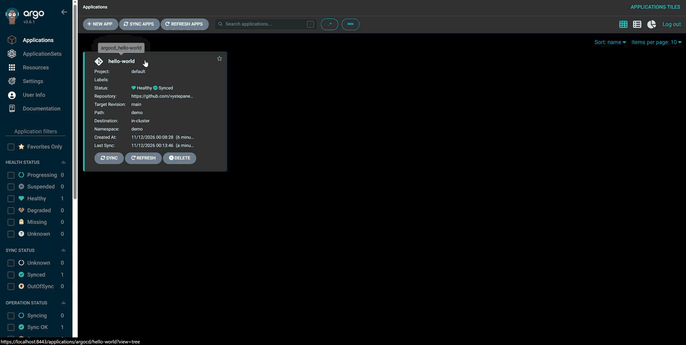
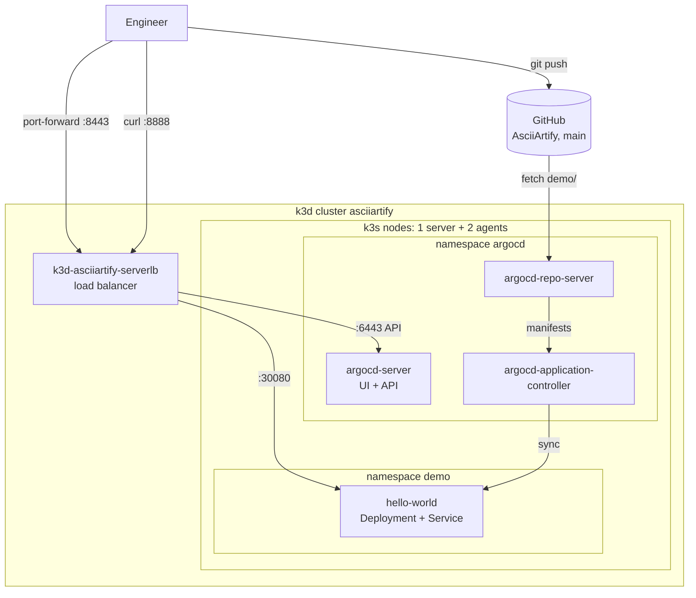

# AsciiArtify — PoC: GitOps with Argo CD on k3d

The [Concept](Concept.md) picked **k3d** as the local Kubernetes for AsciiArtify. This Proof of
Concept checks that a GitOps workflow works on it: a k3d cluster runs [Argo CD](https://argo-cd.readthedocs.io/en/stable/),
the team logs in to the Argo CD web UI, and Argo CD deploys an application straight from this Git
repository and keeps it in the state described in Git.

Result: Argo CD **v3.6.1** runs on a 3-node k3d cluster (k3s **v1.35.5**). The UI is reachable at
`https://localhost:8443`, and the [`hello-world`](../argocd/hello-world-app.yaml) Application syncs
[`demo/`](../demo/hello-world.yaml) from the `main` branch and reverts manual changes. The setup is
ready for the MVP.

All steps below were run on WSL2 on Windows with Docker Desktop 29.9.3 on 2026-11-11.

## Demo




## How it fits together



| Component | Version / value |
|---|---|
| k3d / k3s | v5.9.0 / `rancher/k3s:v1.35.5-k3s1` (pinned) |
| Cluster | `asciiartify`: 1 server + 2 agents, host port 8888 → NodePort 30080 |
| Argo CD | v3.6.1, plain (non-HA) install, namespace `argocd` |
| UI access | `kubectl port-forward` → `https://localhost:8443` (tunnelled through the Kubernetes API, `:6443` on the k3d load balancer), user `admin`, initial password in secret `argocd-initial-admin-secret` (change it, then delete the secret, see step 3) |
| Demo Application | [`argocd/hello-world-app.yaml`](../argocd/hello-world-app.yaml): `demo/` from `main` → namespace `demo`, auto-sync with prune + self-heal |

## Prerequisites

- Docker (Docker Desktop, or any Docker-compatible engine, see the Concept)
- [k3d](https://k3d.io/) v5.9+ and [kubectl](https://kubernetes.io/docs/tasks/tools/)
- Free host ports **8443** (Argo CD UI) and **8888** (demo app). On WSL2 check them first, see
  [Troubleshooting](#troubleshooting)
- Optional: the [`argocd` CLI](https://argo-cd.readthedocs.io/en/stable/cli_installation/). Not
  needed for anything below

## 1. Create the cluster

```bash
k3d cluster create asciiartify \
  --agents 2 \
  --image rancher/k3s:v1.35.5-k3s1 \
  -p '8888:30080@loadbalancer' \
  --wait
kubectl config current-context   # must print k3d-asciiartify
kubectl get nodes
```

k3d switches the current kubectl context to `k3d-asciiartify`. Takes ~30 s. Check the context
before every later step, especially in a new terminal. If your kubeconfig also holds real
clusters, a `kubectl apply` in the wrong context lands there. To switch back:
`kubectl config use-context k3d-asciiartify`.

## 2. Install Argo CD

```bash
kubectl create namespace argocd
kubectl apply -n argocd --server-side --force-conflicts \
  -f https://raw.githubusercontent.com/argoproj/argo-cd/v3.6.1/manifests/install.yaml

kubectl wait -n argocd --for=condition=Available deployment --all --timeout=300s
kubectl rollout status -n argocd statefulset/argocd-application-controller --timeout=300s
kubectl get pods -n argocd
```

- The manifest is pinned to the `v3.6.1` tag rather than `stable`, so every engineer gets the
  same version.
- `--server-side` is required since Argo CD 3.x: the ApplicationSet CRD is larger than the 262 KB
  annotation limit of client-side `kubectl apply`.
- All 7 pods are `Running` after ~1 minute.

## 3. Access the Argo CD UI

**Open a tunnel to the API server** (keep this terminal open):

```bash
kubectl port-forward svc/argocd-server -n argocd 8443:443
```

**Get the initial `admin` password** (in another terminal):

```bash
kubectl -n argocd get secret argocd-initial-admin-secret \
  -o jsonpath='{.data.password}' | base64 -d; echo
```

**Log in.** Open <https://localhost:8443> and accept the browser warning: the default install uses
a self-signed certificate. Log in as `admin` with the password above.

**Change the password, then delete the initial secret:**

1. In the UI open **User Info → Update Password** and set a new password.
2. Delete the secret:

   ```bash
   kubectl -n argocd delete secret argocd-initial-admin-secret
   ```

The secret only stores the generated password in clear text and serves no other purpose. Delete
it only **after** changing the password. If the password is lost, Argo CD can regenerate it (see
the [FAQ](https://argo-cd.readthedocs.io/en/stable/faq/#i-forgot-the-admin-password-how-do-i-reset-it)).

**Optional: the CLI.** Run this while the port-forward is up. *This path was not run in the PoC.*

```bash
argocd login localhost:8443 --insecure --username admin
argocd account update-password
argocd app list
```

`--insecure` is needed because of the self-signed certificate.

## 4. Deploy the first application through GitOps

[`argocd/hello-world-app.yaml`](../argocd/hello-world-app.yaml) is an Argo CD `Application`:

- it watches the `demo/` directory on the `main` branch of this repository;
- it deploys it to the `demo` namespace, creating the namespace if needed;
- it syncs automatically, with `prune` and `selfHeal` enabled.

The Application itself lives in `argocd/` and not in `demo/`, so Argo CD does not try to manage
its own definition.

```bash
kubectl apply -f argocd/hello-world-app.yaml
kubectl wait -n argocd application/hello-world \
  --for=jsonpath='{.status.health.status}'=Healthy --timeout=180s
kubectl get application -n argocd

curl -s localhost:8888
```

In the UI the `hello-world` tile turns **Synced / Healthy** within seconds. Open it to see the
Deployment → ReplicaSet → Pods tree. `curl` returns the ASCII banner with the pod and node that
served the request.

**Self-heal check.** Change the cluster by hand and watch Argo CD revert it to the state in Git:

```bash
kubectl -n demo scale deployment/hello-world --replicas=4
kubectl -n demo get deployment hello-world -w   # back to 2/2 within a few seconds
```

To change the app for real, edit `demo/hello-world.yaml` and push to `main`. Argo CD polls the
repository every 2 minutes plus up to 1 minute of jitter by default; **Refresh** in the UI picks the change up immediately.

## 5. Clean up

```bash
k3d cluster delete asciiartify
```

## Measured on the PoC machine

| Step | Time |
|---|---|
| `k3d cluster create` (3 nodes) | ~28 s |
| Argo CD install → all pods Ready | ~54 s |
| `Application` created → Synced / Healthy | < 10 s |
| Manual scale 2 → 4 → reverted to 2 (self-heal) | ~4 s |

## Team access in the PoC

Each engineer runs the cluster locally and opens the UI with steps 1–3. Everyone uses the built-in
`admin` account. That is enough to check the concept, but not for shared use. For the MVP:

- **Accounts:** local accounts per engineer (`accounts.<name>` in `argocd-cm`) with RBAC in
  `argocd-rbac-cm`, or SSO via the bundled Dex (GitHub login), and the `admin` account disabled.
- **Access without port-forward:** an Ingress (Traefik ships with k3s) with a real TLS
  certificate, once Argo CD runs on a shared cluster.
- **Bootstrap as code:** keep Argo CD's own config (the Application, projects, RBAC) in Git
  (app-of-apps), so a new cluster is one `kubectl apply` away.

## Troubleshooting

- **The browser cannot reach `localhost:8443` (WSL2 / Docker Desktop).** Windows reserves TCP port
  ranges dynamically and silently drops forwards into them. On the PoC machine `8080` from the
  official guide fell into the reserved range 7982–8081, which is why this guide uses `8443`.
  Check the free ranges and pick another port if needed:

  ```bash
  netsh.exe interface ipv4 show excludedportrange protocol=tcp
  ```

- **`curl localhost:8888` returns an empty reply right after the first sync.** The k3d load
  balancer (nginx) hit the NodePort before kube-proxy had set it up. nginx then marked all nodes as
  down for a few seconds. Wait ~10 s and retry.
- **The port-forward stops working.** It breaks when the `argocd-server` pod restarts. Run
  `kubectl port-forward` again.
- **`kubectl apply` fails with `metadata.annotations: Too long`.** The `--server-side
  --force-conflicts` flags are missing from step 2.

## Conclusion

The PoC proves that GitOps works on the k3d setup from the Concept. Argo CD v3.6.1 installs from
the official manifest in about a minute, its UI is available to the team through a port-forward,
and an application defined in this repository is deployed and kept in sync from Git with no manual
`kubectl apply` of the app itself. Next step: the MVP. Deploy the AsciiArtify application through
Argo CD and add per-engineer access.
